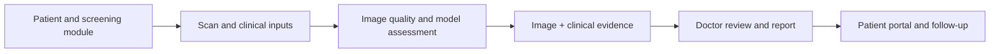
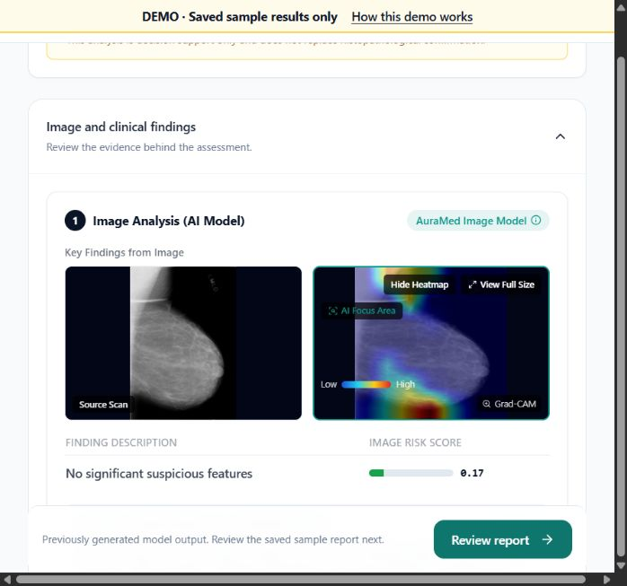
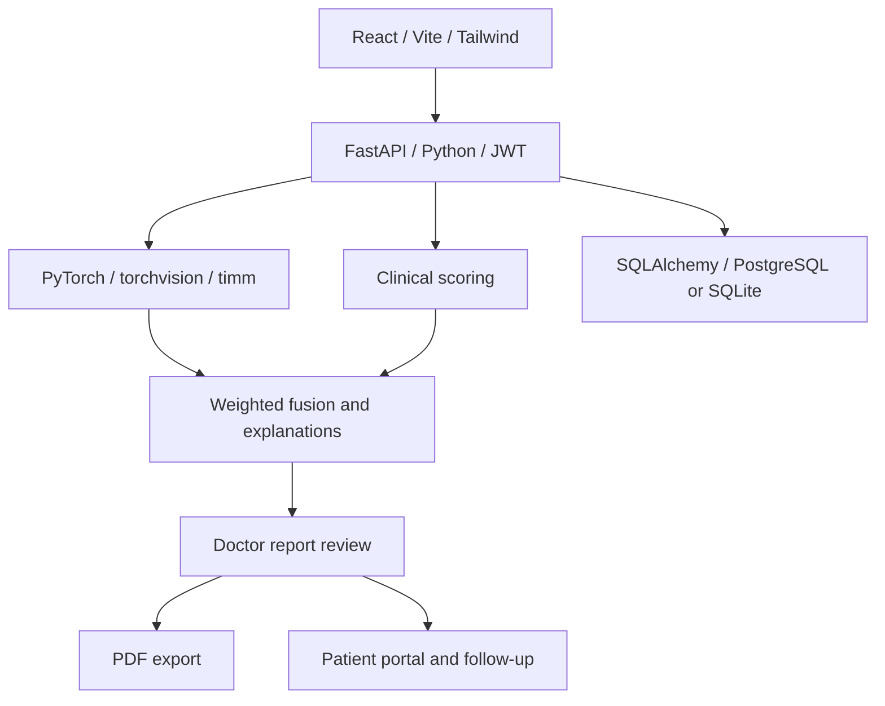

# AuraMed — Clinical Decision Support for Women’s Health

**Team OncoCatch** connects screening evidence, doctor review, reports and patient follow-up across breast screening, cervical cytology and PCOS assessment.

[Live public demo](https://auramed-theta.vercel.app) · [Recorded demonstration](https://youtu.be/Dbne7Zs1pR8) · [Models & releases](https://github.com/shriram-s7/AURAMED_HEALTHCARE_FINAL/releases/tag/v1.0.0) · [Editable presentation](docs/OncoCatch_AuraMed.pptx)

> Research and demonstration prototype. Clinical accuracy and regulatory approval have not been established. Model attention maps support interpretation; they do not establish a diagnosis. PCOS is an endocrine condition, not cancer.

## The workflow



Doctors can manage examinations, inspect image findings and clinical contributions, review reports, export PDFs and coordinate follow-up. Patients have reports, history and appointments. Administrators have user, report and audit views.



## Public demo versus local app

| Capability | Public Vercel demo | Full local app |
|---|---|---|
| Inference | Nine saved examples; no live model execution | Trained PyTorch models |
| Inputs | Fixed sample files and matching clinical fields | Uploaded scans and clinical fields |
| Reports | Labeled sample PDFs | Backend review and PDF workflow |
| Signing/sharing | Simulated within the current tab | Backend workflow; external delivery needs configuration |
| Data | Public sample fixtures | Persistent database and uploads |

The hosted adapter rejects unsupported inputs and writes instead of inventing predictions. Local development always uses the backend. Do not enter personal or patient data in the public demo.

### Sample login accounts

| Role | Email | Password |
|---|---|---|
| Doctor | testdr1@auramed.com | Doctor@123 |
| Patient | testpatient1@auramed.com | Patient@123 |
| Admin | testadmin1@auramed.com | Admin@123 |

These are intentionally public test accounts, also seeded by the local SQLite demo launcher on first use. They are not production credentials.

## Architecture



| Area | Technology |
|---|---|
| Frontend | React 18, JavaScript, React Router, Axios, Recharts, Lucide |
| Backend | FastAPI, Uvicorn, Pydantic, SQLAlchemy, Alembic |
| Breast model | ResNet-50 binary classifier |
| Cervical model | ViT-Base-Patch16-224 via timm |
| PCOS model | ResNet-50 with dropout and a two-class head |
| Clinical assessment | Module-specific scoring and PCOS criteria logic |
| Reporting | ReportLab / WeasyPrint |
| Optional delivery | SMTP and Twilio, requiring separate configuration |

Image and clinical processing run inside the Python backend. No external LLM service is required. Model metadata contains development evaluation artifacts, not independently verified clinical performance.

## Local setup

Install Python 3.11+ and Node.js 22 LTS. CPU inference works, with latency depending on hardware.

```bash
git clone https://github.com/shriram-s7/AURAMED_HEALTHCARE_FINAL.git
cd AURAMED_HEALTHCARE_FINAL
python scripts/download_models.py
cd backend
python -m venv .venv
```

Activate `.venv` using `.\.venv\Scripts\Activate.ps1` on Windows PowerShell or `source .venv/bin/activate` on macOS/Linux, then:

```bash
python -m pip install -r requirements.txt
python tests/run_sqlite_server.py
```

The local demo launcher seeds fictional accounts in a new SQLite database and preserves records on restart. It is for local development. Check startup logs for successful model loading. Missing or incompatible weights leave the affected image prediction unavailable.

Backend: http://127.0.0.1:8000 · API docs: http://127.0.0.1:8000/docs

In another terminal, from the repository root:

```bash
cd frontend
npm ci
```

Copy `.env.example` to `.env` in `frontend`, then run `npm run dev`. Open http://localhost:5173. Keep `VITE_HOSTED_DEMO=false` locally. After initial setup, Windows users may use `start.bat`; the launcher clears ports 8000 and 5173, so use separate terminals if another project owns those ports.

## Model downloads

The release includes the three runtime weights, approximately **507 MiB total**:

| Asset | Size |
|---|---:|
| breast_model.pth | 90 MiB |
| cervical_model.pth | 327 MiB |
| pcos_model.pth | 90 MiB |

Run `python scripts/download_models.py` to install them in `backend/app/ml/weights/`. It verifies SHA-256 hashes and skips matching existing files. Alternatively download them manually from the release. The cervical model exceeds GitHub’s normal file limit, so weights are release assets rather than Git blobs. Duplicate training checkpoints are not published.

[Exact sizes and checksums](backend/app/ml/weights/release-manifest.json)

## Deploy the public frontend

Use `frontend` as the Vercel project root. Its `vercel.json` builds the Vite app and supports client-side routing. Set production variables:

```dotenv
VITE_HOSTED_DEMO=true
VITE_DEMO_ACCESS=true
VITE_BACKEND_CONNECTED=false
```

This serves the saved-example demo, not the Python models. Frontend variables are public: never put secrets in `VITE_*`. For separate backend hosting, see [deploy/HOSTING.md](deploy/HOSTING.md).

## Data and training

Full training datasets, local `demo_data/`, uploaded files, local databases, secrets, virtual environments, caches and generated builds are excluded from Git. Small already-public sample/reference images, fixtures and labeled PDFs remain so the public demo is reproducible. They are not the full training corpus.

Dataset provenance stays alongside samples. Respect the original source terms for datasets and models; this repository grants no additional rights to third-party data. See [training instructions](training/README_training.md). Set your own dataset/output locations in `training/data_config.py`; the supplied paths describe the original development machine. Sample input labels do not guarantee predicted risk categories.

## Verification

```bash
cd frontend
node --test tests/workflow.test.js tests/hostedDemo.test.js
npm run build
```

Backend tests are in `backend/tests/`. Use isolated test databases. Lightweight scoring checks:

```bash
cd backend
python -m pip install pytest
python -m pytest tests/test_clinical_formulas.py tests/test_fusion_and_confidence.py
```

## Project structure

```text
backend/    API, models, scoring, reports and tests
frontend/   Role-based portals and public demo assets
training/   Training, evaluation and model metadata
deploy/     Hosting configuration and sample-export tools
scripts/    Checksum-verified model downloader
docs/       Editable presentation and product screenshot
```

## Team OncoCatch

| Member | Responsibility |
|---|---|
| S Shriram | Team lead; backend, models and fusion |
| Shreedevi S | Frontend and application integration |
| Sidharthan H | UX and patient workflow |
| Sanjay Kanna A B | Quality assurance, documentation and demo preparation |

Contact: [shriram0981234@gmail.com](mailto:shriram0981234@gmail.com)

## Roadmap

Independent clinical evaluation and calibration; secure hosted inference and protected storage; then a supervised clinic pilot measuring review time, comprehension and follow-up completion.

No open-source license has been selected. Public availability does not by itself grant unrestricted reuse. Dependencies and third-party data retain their respective licenses and terms.
